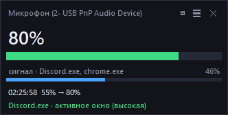
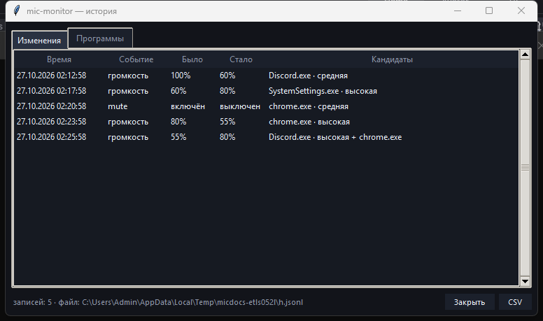

# mic-monitor

Маленький оверлей для Windows: показывает **текущую громкость микрофона**, живой **уровень сигнала**
и **историю того, кто эту громкость менял** — с именем процесса, путём к exe и звуковым сигналом
на каждое изменение.

Повесил поверх окон в углу — и видно, когда Discord/панель Realtek/игра «дёрнули» микрофон,
на сколько и кто был рядом в этот момент.





## Что умеет

- **Оверлей поверх всех окон**: имя устройства записи, громкость в процентах, полоса громкости,
  тонкая полоса уровня сигнала, последнее изменение и подозреваемый процесс.
- **Компактный вид** — только устройство, проценты и полоса.
- **История изменений**: время, было → стало, устройство, подозреваемый и уверенность;
  вторая вкладка — сводка по программам (сколько раз совпала с изменением, какие значения ставила).
- **Текстовый лог** с уликами: `%LOCALAPPDATA%\MicMonitor\mic-monitor.log` — подозреваемый,
  путь к exe, родительский процесс, активное окно, кто держит микрофон, свежие процессы.
- **Звук на изменение** (системный, без внешних файлов). Отключается в меню.
- **Экспорт CSV** и выбор устройства записи из меню.
- Перетаскивание мышью, прозрачность/поверх окон, запоминание позиции.

## Как запустить

**Готовый exe:** скачать `MicMonitor.exe` из [Releases](../../releases) и запустить.
Консольного окна нет, приложение живёт в трее экрана оверлеем.

**Из исходников:**

```powershell
python -m venv .venv
.\.venv\Scripts\python.exe -m pip install -r requirements.txt
.\.venv\Scripts\python.exe mic_monitor.py
```

Или `.\run.ps1` — сам создаст venv и доставит зависимости.

Полезные режимы:

```powershell
python mic_monitor.py --probe        # список устройств записи, громкость, сессии
python mic_monitor.py --watch 60     # лог изменений в консоль без окна, 60 секунд
```

## Управление

- **перетащить** — двигать окно, позиция запоминается;
- **двойной клик** по оверлею — окно истории;
- **правый клик** — меню: история, компактный вид, поверх окон, звук, открыть лог, выбор устройства, выход;
- **✕** — выход.

## Где данные

`%LOCALAPPDATA%\MicMonitor\`

| файл | что внутри |
|---|---|
| `mic-monitor.log` | текстовый лог изменений с уликами (ротация на 1 МБ) |
| `history.jsonl` | те же события в JSON, последние 500 |
| `config.json` | позиция окна, прозрачность, звук, выбранное устройство |
| `mic-history-*.csv` | экспорт из окна истории |

## Честно о главном ограничении

Windows **не сообщает**, какой процесс изменил громкость устройства записи: в Core Audio такого
события нет, есть только новый уровень. Поэтому «виновник» — это **эвристика**, а не факт.

Что реально измеряется: громкость/mute устройства (тот же ползунок, что «Уровень» в настройках),
пик сигнала и список программ, у которых в этот момент открыт микрофон (это настоящие аудио-сессии,
их видно через WASAPI).

Кандидаты набирают вес по признакам:

| признак | вес |
|---|---|
| только что открыл микрофон (≤ 4 с) | 3.2 |
| активное окно в момент изменения | 3.0 |
| запущен только что (≤ 8 с) | 2.2 |
| держит микрофон | 2.0 |
| известная панель управления звуком (Realtek, Sonar, SteelSeries, Voicemeeter…) | +1.2 |

В логе и в окне истории честно пишется уверенность: `высокая` / `средняя` / `низкая`.
Если два процесса одинаково правдоподобны — уверенность будет низкой, и это правильно.

Чего приложение **не** делает: не меняет «Микрофонный усилитель (+дБ)» (это уровень драйвера,
доступный только панели производителя) и не трогает внутреннюю громкость приложения
(Discord/OBS/Teams регулируют свой вход сами).

## Сборка exe

```powershell
.\build.ps1
```

Скрипт создаёт/обновляет venv, ставит зависимости, генерирует иконку (`tools/make_icon.py`),
собирает `dist\MicMonitor.exe` (один файл, без консоли, с иконкой и версией) и копирует его на рабочий стол.

## Тесты

```powershell
.\.venv\Scripts\python.exe -m unittest discover -s tests -v
```

Покрыта чистая логика: определение изменений, взвешивание кандидатов и уверенность, форматирование,
история, текстовый лог, выбор системного звука.

## English

`mic-monitor` is a small always-on-top Windows overlay that shows the current **microphone level**
(recording endpoint volume), the **live input peak**, and a **history of who changed the volume** —
with the suspected process name, executable path, and a sound alert on every change.

Windows exposes no "who changed it" event, so attribution is a documented heuristic (foreground window,
processes holding the mic, freshly started processes, known audio control panels) with an explicit
confidence label. Everything is logged to `%LOCALAPPDATA%\MicMonitor\mic-monitor.log`.

Requires Windows 10/11 and Python 3.10+ for the source build. MIT licensed.

## Лицензия

MIT — см. [LICENSE](LICENSE).
